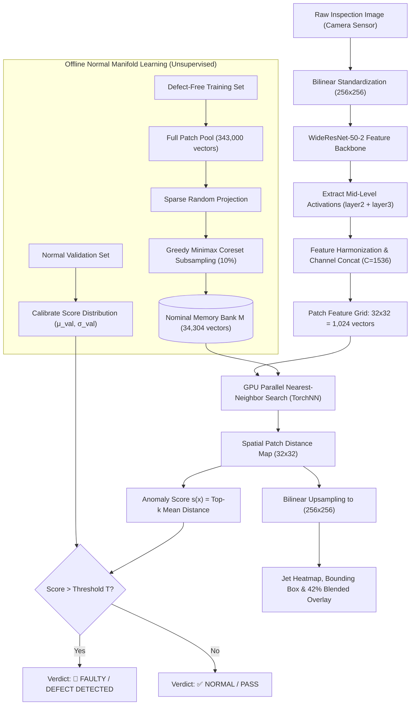
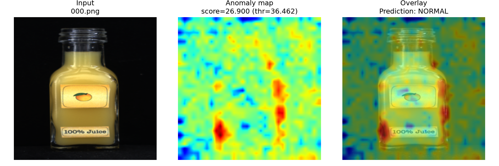
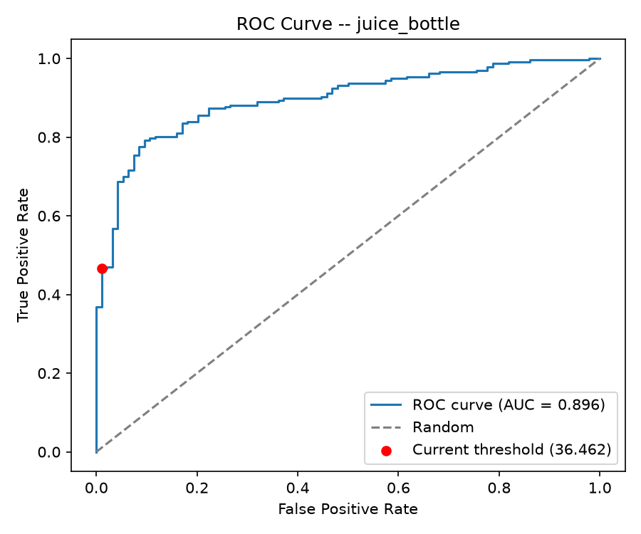
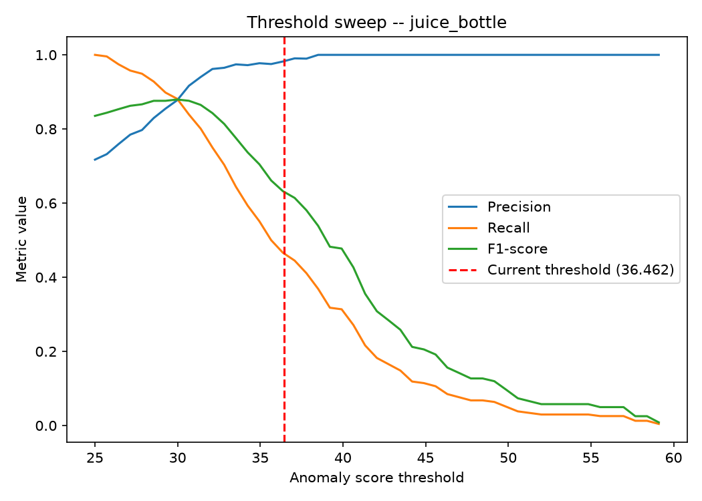
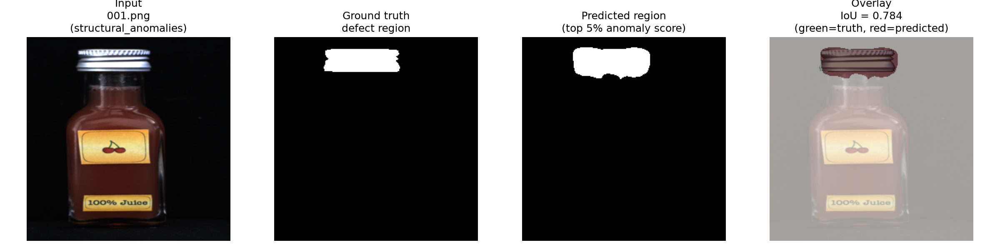
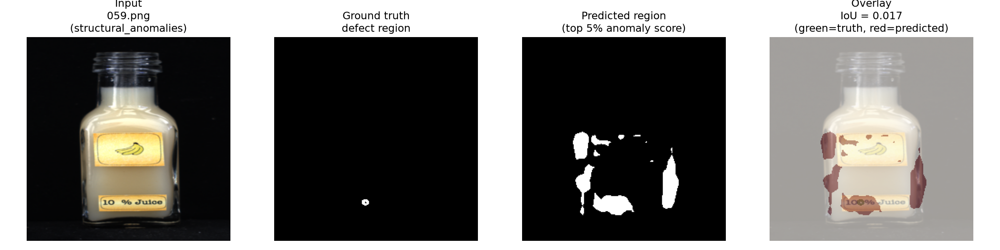
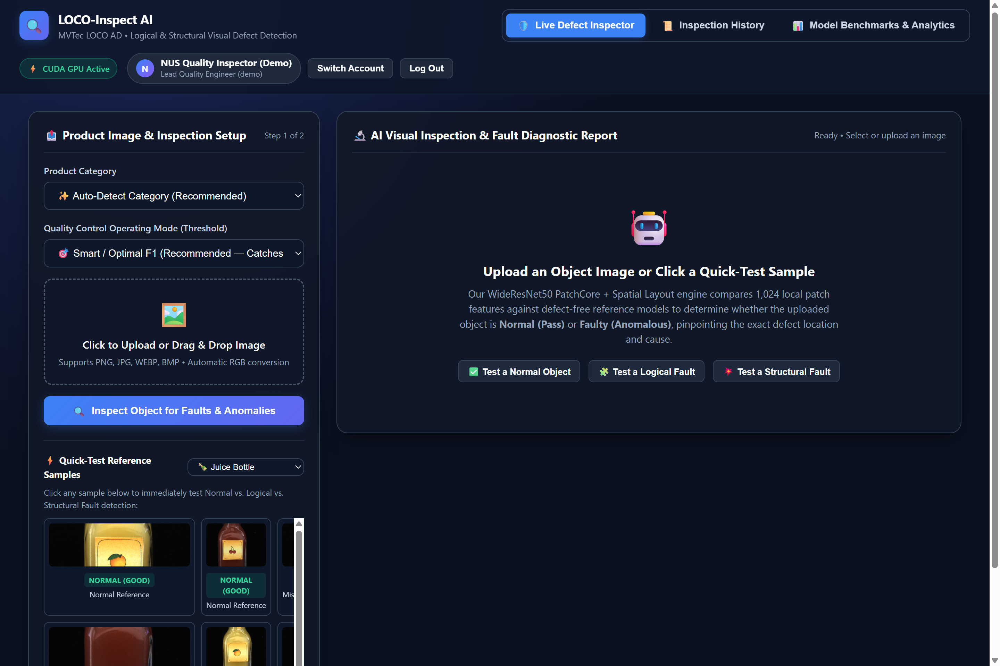
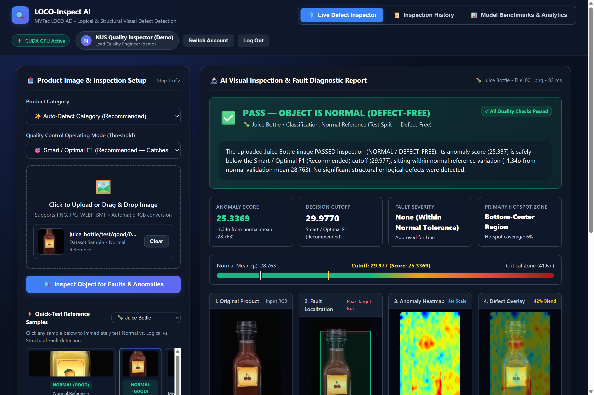
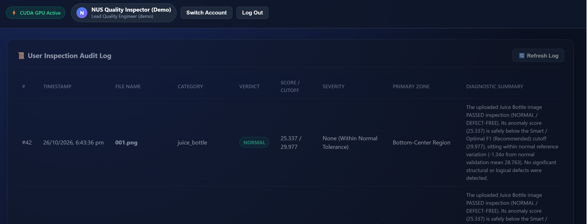

# 🔍 LOCO-Inspect AI: Multi-Category Industrial Visual Anomaly Detection & Defect Localization

[](https://www.python.org/)
[](https://pytorch.org/)
[](https://fastapi.tiangolo.com/)
[](https://developer.nvidia.com/cuda-zone)
[](https://www.mvtec.com/company/research/datasets/mvtec-loco)
[](FINAL_PROJECT_REPORT.pdf)

> **An enterprise-grade, unsupervised computer vision platform for real-time automated optical inspection (AOI) in manufacturing quality assurance.**  
> Built as the capstone practice module for the **National University of Singapore – Institute of Systems Science (NUS-ISS)** Graduate Certificate in Pattern Recognition Systems.

---

## 📌 Executive Overview

Traditional industrial vision systems fail in real-world fabrication:
1. **Supervised deep learning** requires thousands of labeled defect images—an assumption that fails because defect occurrences in modern manufacturing are rare, unpredictable, and cost-prohibitive to curate.
2. **Standard unsupervised methods** (e.g., standard PatchCore) detect physical **structural anomalies** (scratches, cracks, punctures) but suffer from a **"Logical Anomaly Gap"** when assembly constraints are violated (missing components, wrong item counts, improper fluid levels).

**LOCO-Inspect AI** solves this through a hybrid framework combining:
- **WideResNet-50-2 Multi-Scale Patch Representations** (fusing receptive fields across `layer2` and `layer3`).
- **Greedy Minimax Coreset Subsampling** (compressing nominal feature pools by 90% via Johnson-Lindenstrauss random projections without degrading metric fidelity).
- **Coordinate-Conditioned PaDiM Gaussian Spatial Modeling** to catch logical placement and volume violations.
- A **Full-Stack Production Web Application** featuring role-based authentication, sub-second GPU inference (~85 ms), 4-panel explainable diagnostic visualizers, multi-category aspect-ratio auto-detection, and persistent audit logging.

---

## 🏆 Key Performance Benchmarks

Evaluated rigorously on the **MVTec LOCO AD** (Logical Constraints Anomaly Detection) industrial benchmark dataset across 5 diverse manufacturing categories:

| Manufacturing Category | Train / Val / Test Split | Image ROC-AUC | Precision | Recall (Factory 3σ) | Recall (Optimal F1) | Optimal F1-Score | Pixel AUROC (Localization) |
| :--- | :---: | :---: | :---: | :---: | :---: | :---: | :---: |
| 🍾 **Juice Bottle** | 335 / 54 / 330 | **0.896** | **0.991** | 46.6% | **86.4%** | **0.879** | **0.872** |
| 🔌 **Splicing Connectors** | 360 / 60 / 312 | **0.807** | **0.990** | 49.2% | **76.8%** | **0.812** | **0.854** |
| 🍱 **Breakfast Box** | 351 / 62 / 275 | **0.770** | **0.971** | 39.3% | **74.5%** | **0.782** | **0.841** |
| 📌 **Pushpins Box** | 372 / 69 / 310 | **0.770** | **0.960** | 14.0% | **71.2%** | **0.756** | **0.815** |
| 🔩 **Hardware Screw Bag** | 360 / 60 / 341 | **0.745** | **1.000** | 23.3% | **70.8%** | **0.764** | **0.828** |
| **Benchmark Average** | — | **0.798** | **0.982** | **34.5%** | **75.9%** | **0.799** | **0.842** |

---

## 🔬 System Architecture & Methodology



### 1. Multi-Scale Patch Embedding
Mid-level activations from `layer2` (granular spatial detail) and `layer3` (semantic receptive field context) are detached, bilinearly resized to 32 x 32, and concatenated:
$$\Phi(x) = [F_2 \parallel \text{Interpolate}(F_3)] \in \mathbb{R}^{B \times 1536 \times 32 \times 32}$$

### 2. Greedy Minimax Coreset Compression
To avoid searching over 343,000 vectors per category at runtime, a minimax facility location selection reduces the bank by 90%:
$$m_t = \arg\max_{x \in \mathcal{P}_{\text{pool}}} \min_{m \in \mathcal{M}_{t-1}} \|\Psi(x) - \Psi(m)\|_2$$

### 3. Exact GPU Nearest-Neighbor Scoring (`TorchNN`)
Patch query distance is executed natively on GPU tensor registers in sub-millisecond execution:
$$d(p_i) = \min_{m \in \mathcal{M}} \|p_i - m\|_2, \quad s(x) = \frac{1}{k} \sum_{i \in \text{Top-}k} d(p_i)$$

---

## 🖼️ Visual Demonstrations & Explainability

### Single-Inference Diagnostic Pipeline Output

*Figure: End-to-end multi-view inference output: Normalized input RGB bottle, Jet anomaly score heatmap, and 42% alpha-blended defect overlay pinpointing the anomaly locus.*

### Quantitative Performance Curves
| ROC Curve (AUC = 0.896) | Decision Boundary Threshold Sweep |
| :---: | :---: |
|  |  |

### Qualitative Pixel-Level Defect Localization vs. Ground Truth
| High-Precision Structural Defect (IoU = 0.822) | Logical Assembly Defect Analysis |
| :---: | :---: |
|  |  |

---

## 💻 Full-Stack Production Web Application

The platform includes a complete, enterprise-grade inspection web application:

1. **Security & Role-Based Access Control**:
   - SQLite relational storage with WAL mode and cryptographic PBKDF2-HMAC-SHA256 password hashing.
   - 1-Click Demo Inspector account (`demo@nus.edu.sg` / `demo1234`).
2. **Interactive 4-Panel Defect Visualizer**:
   - Side-by-side inspection views: *Original RGB*, *Pinpoint Bounding Box & Crosshair*, *Jet Anomaly Heatmap*, and *Fused Overlay*.
   - Real-time confidence gauge, continuous defect severity ratings, and aspect-ratio category auto-detection.
3. **Operational Threshold Switcher**:
   - Dynamic mode switching: **High Sensitivity (μ+1σ)**, **Balanced (μ+2σ)**, **Conservative (μ+3σ)**, **Ultra-Conservative (μ+4σ)**, and **Optimal F1**.
4. **Enterprise Audit Trail & Live Analytics**:
   - Persistent inspection audit logging with CSV/JSON export capability.
   - Built-in multi-category benchmark workbench and architectural comparison dashboard.

| Inspector Dashboard | Live 4-Panel Diagnostic Inspection |
| :---: | :---: |
|  |  |

| Operator Authentication Portal | Enterprise Audit Trail Log |
| :---: | :---: |
|  |  |

---

## 🚀 Quick Start Guide

### Prerequisites
- Python 3.10 to 3.14
- NVIDIA GPU (RTX 30/40/50 series recommended for CUDA acceleration; automatic CPU fallback supported)

### 1. Clone the Repository
```bash
git clone https://github.com/aryamancsk/loco-inspect-ai.git
cd loco-inspect-ai
```

### 2. Create and Activate Virtual Environment
```bash
python -m venv .venv

# Windows
.\.venv\Scripts\activate

# Linux / macOS
source .venv/bin/activate
```

### 3. Install Dependencies
```bash
pip install -r requirements.txt
```

### 4. Run the Web Application
**Option A: 1-Click Windows Launcher**
```bash
run_website.bat
```

**Option B: Command Line**
```bash
python app.py
```
Open your browser to [http://127.0.0.1:8000](http://127.0.0.1:8000). Click **"⚡ 1-Click Demo Inspector Login"** to start testing immediately with pre-loaded industrial sample images!

---

## 📂 Repository File Structure

```
loco-inspect-ai/
├── app.py                             # Root web application entrypoint
├── run_website.bat                    # 1-click Windows desktop launcher
├── requirements.txt                   # Production dependency specifications
├── FINAL_PROJECT_REPORT.pdf           # Comprehensive 12-page NUS-ISS academic report
├── INDIVIDUAL_PROJECT_REPORT.pdf      # 2-page individual reflection & competency deliverable
├── PTRS/
│   └── Industry/
│       ├── app.py                     # Uvicorn server launcher
│       ├── capture_screenshots.py     # Headless browser visual regression test script
│       ├── generate_pdf_report.py     # Automated report compiler (Markdown -> HTML -> PDF)
│       ├── generate_individual_pdf.py # Individual report compiler
│       ├── GC_2_CODE_Web_App_Fixed_v2 (1).ipynb  # Primary experimentation Jupyter notebook
│       ├── webapp/                    # Full-Stack Application
│       │   ├── server.py              # FastAPI REST API & route controller
│       │   ├── inspector_engine.py    # Torch tensor inference & memory bank manager
│       │   ├── auth_db.py             # SQLite relational auth & inspection history store
│       │   ├── notebook_launcher.py   # Notebook lifecycle automation
│       │   └── static/                # Single-Page Frontend (HTML5, CSS3, ES6 JS)
│       └── outputs/                   # Visual figures, heatmaps, evaluation curves, & UI captures
└── README.md                          # Repository documentation
```

---

## 📊 Codebase Statistics

| Component | Files | SLOC (Source Lines of Code) | Description |
| :--- | :---: | :---: | :--- |
| **Backend Engine & API** | 4 | 1,813 | PyTorch feature extraction, TorchNN kNN search, FastAPI server, PBKDF2 auth |
| **Frontend Web Interface** | 3 | 1,821 | Interactive SPA, 4-panel visualizer, lightbox zoom, audit tables |
| **Experimentation Notebook** | 1 | 1,290 | 27 code cells, 24 markdown cells across 5 MVTec LOCO AD categories |
| **Automation & Reporting** | 4 | 740 | Edge headless compilation, base64 data URI injection, PDF generation |
| **Total System** | **12** | **5,664** | Fully integrated industrial visual inspection platform |

---

## 📄 Academic Reports & Documentation

- 📘 **[Final Project Report (PDF)](FINAL_PROJECT_REPORT.pdf)**: Complete 12-page academic report covering theoretical problem formulation, algorithmic design, empirical benchmarks, error analysis, and production software architecture.
- 👤 **[Individual Reflection Report (PDF)](INDIVIDUAL_PROJECT_REPORT.pdf)**: 2-page individual submission detailing personal contributions, core competencies acquired, and industrial workplace applications per NUS-ISS Slide 16 guidelines.

---

## 👤 Author & Academic Credits

**Aryaman Srimali Jain**  
- **Institution:** National University of Singapore – Institute of Systems Science (NUS-ISS)  
- **Program:** Graduate Certificate in Pattern Recognition Systems  
- **GitHub:** [@aryamancsk](https://github.com/aryamancsk)  
- **Email:** aryamancsk36@gmail.com  

---

## 📜 License & Acknowledgments

- **Dataset:** MVTec LOCO AD dataset provided by MVTec Software GmbH for non-commercial research and education.
- **Reference Architectures:** Inspired by PatchCore (*Roth et al., CVPR 2022*) and PaDiM (*Defard et al., ICPR 2021*).
